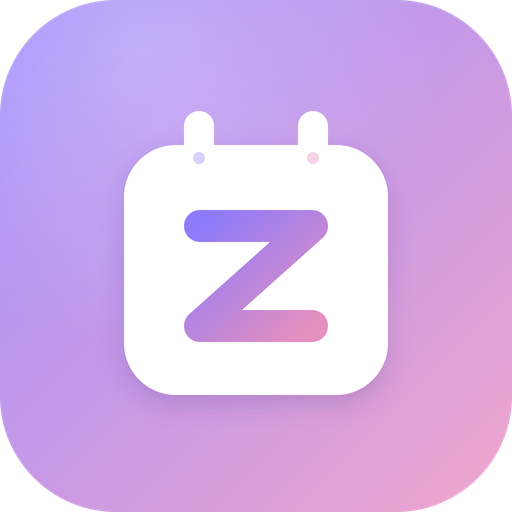

# ZenCalendar

ZenCalendar es mi calendario. Lo hice porque quería uno bonito de verdad, pastel y tranquilito, que fuera igual en el móvil y en el PC, que me avisara de las cosas aunque estuviera cerrado y que se sincronizara sin tener que hacerme otra cuenta en ningún sitio. Es la primera app de una pequeña colección (después vendrán un reloj y los recordatorios).

<p align="center"></p>

## Creador

**luckicla**: quien hace ZenCalendar (y [MixUp](https://github.com/luckicla/zentor)).

## Descargar

Todo está en la web, **[luckicla.github.io/zencalendar](https://luckicla.github.io/zencalendar/)**, y en [Releases](https://github.com/luckicla/zencalendar/releases/latest):

- **Windows, instalador**: `ZenCalendar-Instalador.exe`. Se instala como una app más (menú Inicio y escritorio), se queda junto al reloj para avisarte y se actualiza sola.
- **Windows, portable**: `ZenCalendar-Portable.exe`. Sin instalar: los datos van en una carpeta `ZenCalendar-datos` al lado del `.exe`. Te avisa cuando hay versión nueva.
- **Android**: `ZenCalendar.apk`. Se instala a mano la primera vez (Android 7 o más nuevo) y después **se actualiza sola**: al abrirla mira si hay una nueva (como mucho cada 6 horas, o cuando tú quieras desde Ajustes), la descarga, comprueba que llega entera y te enseña el instalador de Android. La primera vez Android te pedirá permitir que ZenCalendar instale apps; después se vuelve a abrir sola y te dice «Actualizado a la versión…».
- **En el navegador**: [luckicla.github.io/zencalendar/app](https://luckicla.github.io/zencalendar/app/), por si estás en un ordenador que no es el tuyo. Se puede instalar como app desde el navegador.

Si Windows o Android te dicen que es peligroso, lee [¿Es seguro?](#es-seguro), que está explicado.

Las versiones van así: 1.0.0, 1.0.1, 1.0.2… (el número está en el archivo [`VERSION`](VERSION)). La de Windows instalada se actualiza sola a cada versión nueva; la de Android, además, recibe cada arreglo en cuanto se compila (con el mismo número de versión y un número de compilación más alto); la web se actualiza al recargarla.

## Qué hace

**Tu agenda**
- Vistas de mes, semana, día, agenda y año. Arrastras para mover, crear o alargar eventos; en el móvil deslizas para cambiar de mes.
- Eventos y tareas (con su casilla), de todo el día o de varios días, con lugar (enlace a mapas), notas, emoji, color, imágenes y lista de cosas.
- Repeticiones: cada día, cada semana (los días que quieras), cada mes (el día 15 o «el tercer martes»), cada año, cada X, hasta una fecha o X veces. Puedes cambiar o borrar solo una, esta y las siguientes, o todas.
- Varios calendarios con sus colores (Personal, Trabajo, Cumpleaños… y los que quieras).
- Festivos de España ya puestos (con la Semana Santa calculada), y los de algunas comunidades.
- Importa lo que exportas de Google Calendar (`.ics`) y exporta igual. También copia de seguridad en un archivo.

**Escribir como hablas**
- La barra de «añadir rápido» entiende cosas como *«mañana a las 5 dentista»*, *«cena con Marta el viernes 21:30 en Casa Pepe»*, *«cada lunes gimnasio a las 7 de la tarde»*, *«del 3 al 7 de diciembre vacaciones»* o *«recuérdame comprar pan»*. Sin internet, al momento, en español, inglés y algo de catalán.

**IA (si quieres)**
- Le pides cosas al calendario: *«muéveme el dentista al jueves»*, *«¿qué tengo mañana?»*, *«borra la cena»*. Siempre te enseña lo que va a cambiar antes de hacerlo.
- Le das una foto de un cartel, una entrada o un horario y saca los eventos.
- Puedes usar la integrada (sin internet), un modelo abierto que funciona dentro de tu propio dispositivo (se descarga una vez, privado), Ollama en tu PC, o una API: Gemini (gratis con clave), Groq, OpenRouter, OpenAI, Claude, Mistral o cualquiera compatible con OpenAI. Las claves se quedan solo en tu dispositivo.

**Avisos y widgets**
- Avisos a la hora que digas (10 min antes, 1 día antes…), aunque la app esté cerrada. En Android con «Posponer 10 min» y «Hecho»; en Windows desde la bandeja del sistema.
- Android: widgets «Agenda» y «Hoy» con los colores de tu tema y la transparencia que elijas.
- Windows: un widget de escritorio con tu agenda, que puedes dejar siempre encima o quieto en el escritorio (sin ponerse delante de las ventanas al tocarlo).

**Sincronizar con Google Drive**
- Un solo botón: «Conectar con Google». Tus eventos, calendarios y ajustes se guardan en una carpeta oculta de **tu** Drive (la app no puede ver nada más de tu Drive) y así tienes lo mismo en el móvil, en el PC y en la web.
- Si cambias cosas en dos sitios a la vez, se juntan sin perder nada. Sin conexión funciona igual y se sincroniza cuando vuelve.

**A tu gusto**
- Temas claros y oscuros (Nube, Sakura, Menta, Lavanda, Noche pastel…), fondos animados suaves, imagen de fondo, transparencias, esquinas, letras y el icono de la app (6 colores, y el de Dot).
- Dos diseños: **Zen** (el pastel de siempre) y **Dot**, monocromo, con un solo color de acento y los números en puntos (inspirado en el estilo de Nothing OS). También los widgets se cambian.
- Está en español, inglés y catalán.

## ¿Es seguro?

**Sí, es seguro.** Windows y Android pueden decir que ZenCalendar es «peligroso» o «no seguro», pero no es por lo que hace. Es porque **no está firmado** con un certificado de pago y no viene de una tienda oficial.

- **Windows (SmartScreen: «Windows protegió su PC»).** Windows desconfía de cualquier programa que no lleve una firma de código comprada (cuesta cientos de euros al año) y que todavía no se haya descargado mucho. Dale a *Más información → Ejecutar de todas formas*.
- **Android (Play Protect: «App no segura»).** Android avisa de cualquier app que no venga de Google Play. La APK va firmada con una clave de desarrollo pública (`android/app/zencalendar-dev.keystore`). Dale a *Más detalles → Instalar de todas formas*.

Lo que hace de verdad ZenCalendar:

- Todo el código está aquí, abierto. La APK y los `.exe` de las releases los compila **GitHub Actions** a partir de este mismo código (`.github/workflows/build.yml`), no mi ordenador.
- Tus eventos se guardan en tu dispositivo. Solo salen de él si conectas Google Drive (y entonces van a **tu** Drive, a una carpeta oculta que solo ve ZenCalendar) o si usas una IA de internet (y entonces solo lo que le pides y tu agenda de las próximas semanas, para que sepa contestar).
- No tengo servidores, no hay cuentas de ZenCalendar, no hay anuncios y no se manda nada a ningún sitio más.
- Solo se conecta a internet para eso: Google Drive (si lo conectas), la IA que elijas si eliges una de internet (o, si eliges la del dispositivo, para descargar el modelo una vez), Google Fonts para las letras de la interfaz (sin internet usa las del sistema) y GitHub para mirar si hay versión nueva (en Android y Windows).
- En Android pide permiso para notificaciones (los avisos), para poner alarmas a la hora exacta y, solo cuando le das a actualizar, para instalar apps (para instalar su propia APK nueva, descargada de este repo y comprobada con su sha256). Nada de contactos, ubicación ni archivos.

**Si quieres comprobarlo tú**, no hace falta que te fíes de mí:

- Sube `ZenCalendar-Instalador.exe` o `ZenCalendar.apk` a [VirusTotal](https://www.virustotal.com), que lo pasa por más de 70 antivirus a la vez.
- O pásale el código (o el enlace a este repo) a una IA como Claude y pídele que lo revise y te explique qué hace cada parte.

## Cómo está hecho

Es la misma interfaz en todos lados: HTML, CSS y JavaScript sin frameworks y sin compilar nada (como MixUp), todo colgado de un objeto `ZC`. En Android va dentro de un WebView con un poco de Java para lo que la web sola no puede (avisos, widgets, Google); en Windows dentro de Electron, con su ventana sin marco, la bandeja y el widget de escritorio.

```
web/                  la interfaz (la misma en Android, Windows y la web)
  index.html, widget.html, css/, js/ui/    lo que se ve
  js/core/            lo de dentro:
    store.js          dónde se guarda todo (IndexedDB) y cómo se juntan los cambios
    recur.js          las repeticiones
    nlp.js            «mañana a las 5 dentista» → evento
    ics.js            importar/exportar .ics
    holidays.js       festivos
    drive.js          sincronizar con Google Drive
    ai.js             la IA (integrada, en el dispositivo, Ollama o APIs)
    reminders.js      los avisos y los datos de los widgets
    platform.js, net.js, core.js   lo que cambia según dónde va la app
  manifest.webmanifest, sw.js      para instalarla desde el navegador y usarla sin conexión
android/              la app de Android (Java): WebView, avisos, widgets, inicio de sesión de Google
desktop/              la app de Windows (Electron): ventana, bandeja, avisos, widget, Google, actualizaciones
tools/mkicons.py      todos los iconos a partir de assets/logo.svg
tools/mkfont.py       ZenDot, la letra de puntos del diseño Dot (assets/fonts/)
tests/core/           pruebas de lo de dentro (node tests/core/run.js)
docs/                 la web de presentación, y GOOGLE-SETUP.md
```

La app la he hecho yo. Me he ayudado de Claude, la IA de Anthropic, para arreglar errores y en algunas partes, pero no ha hecho toda la app.

## Compilar

No hace falta compilar la interfaz: abre `web/index.html` con un servidor cualquiera (por ejemplo `python3 -m http.server` dentro de `web/`).

- **Android**: Android Studio, o `gradle assembleRelease` dentro de `android/` con Java 17, Gradle 8.9 (no hay *wrapper*: el de GitHub Actions es el 8.9) y el SDK de Android 34. Copia `web/` dentro de la APK al compilar y la firma con la clave de desarrollo del repo. Sale en `android/app/build/outputs/apk/release/app-release.apk`.
- **Windows**: dentro de `desktop/`, `npm install` y `npm start` para probar, o `npm run dist` (en Windows) para el instalador y la portable, que salen en `desktop/dist/`.
- **Iconos**: `python3 tools/mkicons.py` (hace falta `rsvg-convert` y Pillow).
- **Pruebas**: `node tests/core/run.js`.

De todas formas, GitHub Actions lo hace solo en cada cambio en `main`:

- `.github/workflows/build.yml` pasa las pruebas, compila la APK (Ubuntu) y el instalador y la portable (Windows), y los sube a tres sitios de [Releases](https://github.com/luckicla/zencalendar/releases):
  - `android-latest`: la última `ZenCalendar.apk`, siempre en el mismo enlace, con `version.txt` («`<compilación> <sha256> <versión>`»). La app de Android se actualiza desde aquí: compara su número de compilación (`versionCode` = el número de la ejecución de GitHub Actions, que siempre sube) con el de `version.txt`, descarga la APK y comprueba el sha256.
  - `pc-latest`: el último `ZenCalendar-Instalador.exe` y `ZenCalendar-Portable.exe`. De aquí se actualiza sola la versión instalada (electron-updater, con `latest.yml`), pero solo cuando cambia `VERSION` (compara la versión); la portable mira `version.txt` y, si hay una nueva, «Actualizar» abre la descarga.
  - `v<VERSION>` (por ejemplo `v1.0.0`): la release oficial, con los tres archivos y las notas, marcada como *latest*. De aquí salen los botones de descarga de la web (`releases/latest/download/…`). Se crea una sola vez por versión: en la primera compilación en la que salen bien Android y Windows (si una falla, la siguiente lo vuelve a intentar con el mismo número).
- `.github/workflows/pages.yml` publica la web: la presentación (`docs/`, sin los documentos internos) en `luckicla.github.io/zencalendar/` y la app (`web/`) en `luckicla.github.io/zencalendar/app/`. **Antes de la primera vez** hay que ir a **Settings → Pages → Build and deployment → Source** y elegir **GitHub Actions** (si no, el paso de publicar falla).

**Sacar una versión nueva**: cambia el número del archivo `VERSION` (por ejemplo de `1.0.0` a `1.0.1`) y súbelo a `main`. GitHub Actions compila, crea la release `v1.0.1` con sus notas y la marca como la última; la de Windows instalada se actualiza sola y la de Android también. Los cambios que subas sin tocar `VERSION` llegan igual a Android (y a `android-latest`/`pc-latest`), pero no crean release oficial.

Para que funcione «Conectar con Google» hay que hacer una vez lo de [docs/GOOGLE-SETUP.md](docs/GOOGLE-SETUP.md). Sin eso la app funciona igual, solo que sin sincronizar.

## Licencia

ZenCalendar es de código abierto para uso **no comercial**, con la licencia [PolyForm Noncommercial 1.0.0](LICENSE). © 2026 luckicla.

- **Puedes** ver el código, usarlo, aprender de él, cambiarlo y compartirlo, siempre que no sea para ganar dinero y mantengas el aviso de copyright y la licencia.
- **No puedes** venderlo, cobrar por él ni usarlo para fines comerciales. Eso solo lo puedo hacer yo. Si quieres usarlo de forma comercial, pídeme permiso.

La letra de puntos **ZenDot** (`assets/fonts/`) también es mía y va con la [SIL Open Font License 1.1](assets/fonts/OFL.txt): esa sí la puedes usar donde quieras.

El nombre «ZenCalendar» y sus logos son míos: si publicas una versión cambiada, ponle otro nombre y otro logo.
